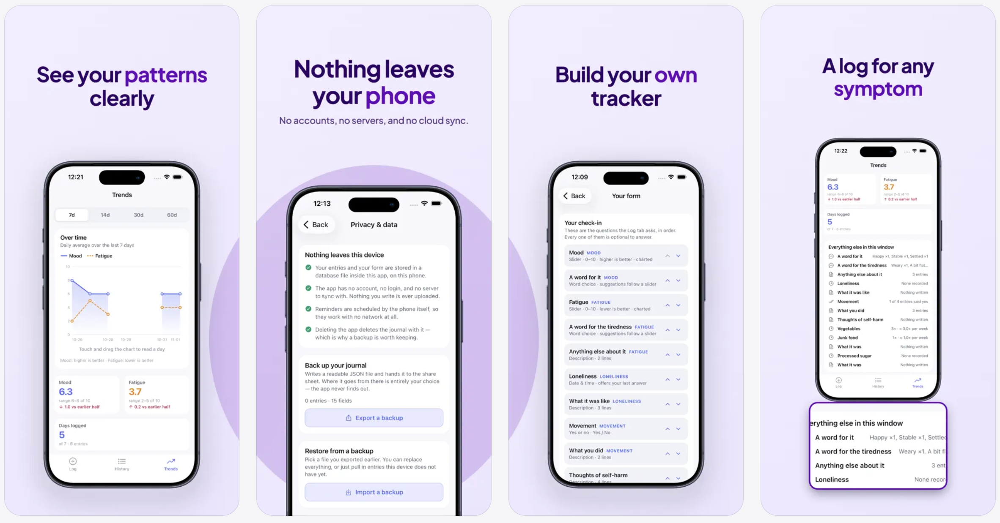

# Mood Tracker

**A mood journal that's actually private — because it has nowhere to send your data.**

No account. No sign-up. No cloud sync. No analytics. Mood Tracker runs
entirely on your iPhone, and the form you fill in every day is one *you*
design — not one some product team decided everyone should use.

[**Download on the App Store →**](https://apps.apple.com/us/app/mood-tracker/id6829317992)

## Why people trust it with sensitive stuff

Mood, sleep, energy, triggers, side effects — the things worth tracking are
often the things you'd least want sitting on someone else's server. So Mood
Tracker doesn't have a server.

- **Nothing leaves your phone.** Entries are stored in a database file inside
  the app, on your device. There's no account to create and nothing to upload.
- **No analytics, no crash reporting, no telemetry.** Not even the anonymous
  kind. The app has no way to know how — or whether — you're using it.
- **Reminders work with no network at all.** They're scheduled by iOS itself,
  not by a server pinging your phone.
- **You're never locked in.** Export a readable backup whenever you like, and
  delete everything with one button whenever you don't.

## What it does

- **Log your day, your way.** Sliders, word pickers, free text, date & time,
  yes/no — pick the fields that matter to you, in the order you want. Every
  question is optional, always.
- **Build your own tracker.** Add, rename, reorder, or retire fields any time
  from **Your form**. Retiring a field keeps your old answers readable —
  deleting the data itself is a separate, deliberate step.
- **See your patterns clearly.** Trends charts your sliders over the last
  7, 14, 30, or 60 days, with simple summary stats so you can actually notice
  what's changing.
- **Gentle daily nudges.** Three reminders a day, each at a time you choose,
  with wording that varies so it never feels like the same stale notification.
- **A log for any symptom.** Mood is the default, but the same builder works
  for sleep, pain, medication, habits — anything you want a daily pulse on.
- **Back up on your terms.** Export a plain, readable JSON file through the
  share sheet whenever you want a copy — restore it fully or just fill in
  what's missing.

New installs get a choice: start from the full check-in this app ships with,
a minimal mood-only form, or a completely blank slate.

## Get it

**[Mood Tracker on the App Store](https://apps.apple.com/us/app/mood-tracker/id6829317992)**

---

## For developers

Mood Tracker is open source, built with Expo and React Native. If you want
to set it up locally, understand how it's built, modify it, or ship your own
release, the full developer guide — stack, project layout, data model,
backups, reminders, EAS/Xcode release steps, and more — lives in
**[docs/DEVELOPMENT.md](docs/DEVELOPMENT.md)**.
